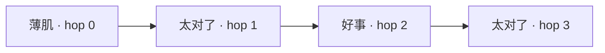

# Architecture

The port is one .NET Framework / WPF process with three independent transparent `Window` instances. Each window owns a `MediaPlayer`, shuffle queue, caption timer, animation and saved preference file. The windows remain visible in the taskbar so they can be found on Windows.

`Program.Trigger` advances a generation number, stops existing audio and starts a new chain. Every scheduled response checks its generation before playing. A closed or opted-out pet is skipped, and the hop count stops at 3. Completion events, rather than estimated clip durations, schedule the next response.

The application does not load or execute upstream code. Preparation downloads GitHub source archives pinned in `upstream.lock.json`, copies only the enumerated asset files, and validates their hashes. Generated assets, archives, executables, logs and local settings are excluded from Git.

Preferences and logs stay in `%LOCALAPPDATA%\GanzhePets`. A session-scoped named mutex prevents duplicate production instances; a named event lets a second invocation restore the existing windows. Diagnostic modes intentionally bypass the production mutex, use default preferences, and mute audio.

The implementation currently lives in `src/Pets.cs`: data classes, process/chain coordination, pet windows and media self-test. It compiles with the .NET Framework compiler and requires no NuGet packages.
